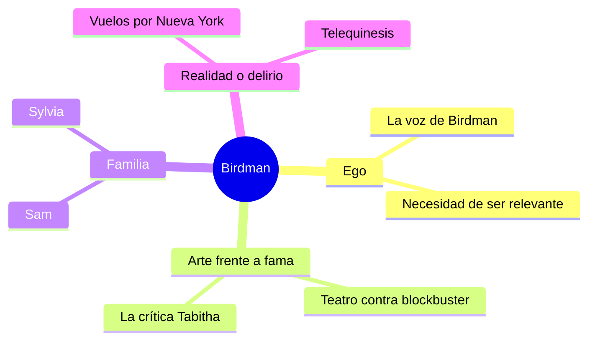
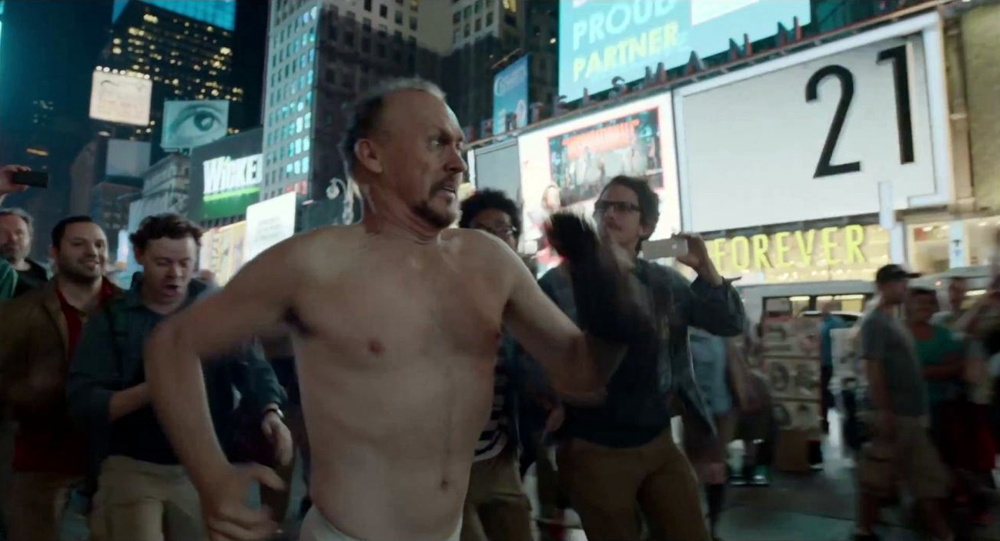
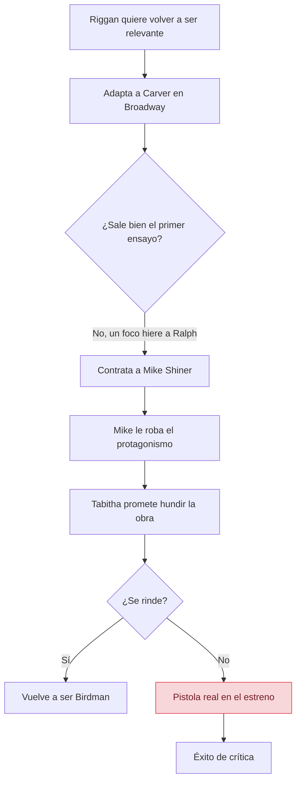
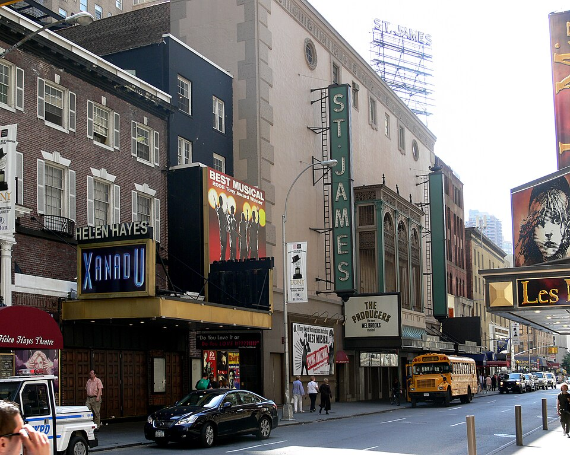
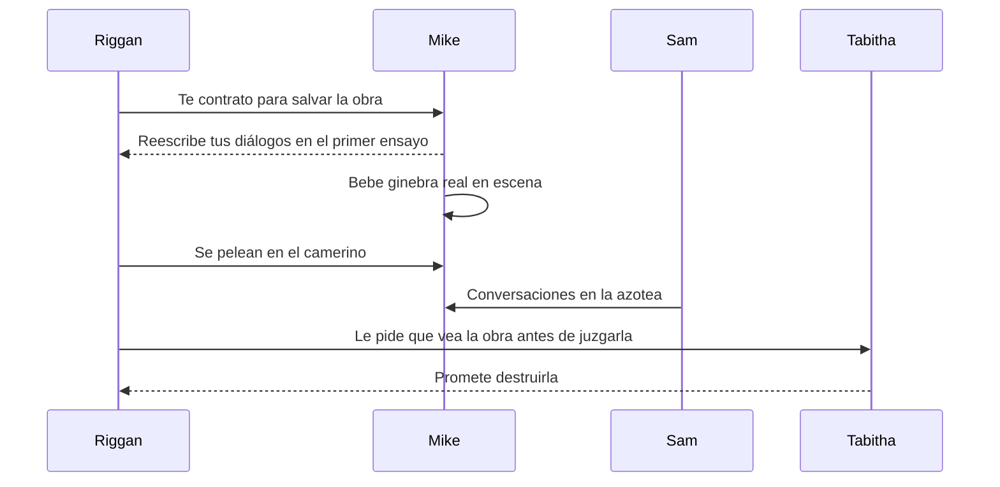
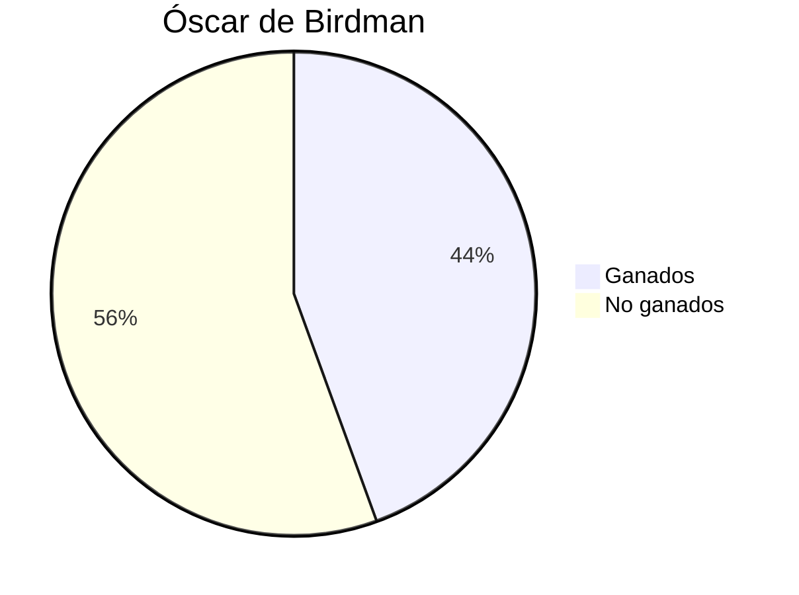
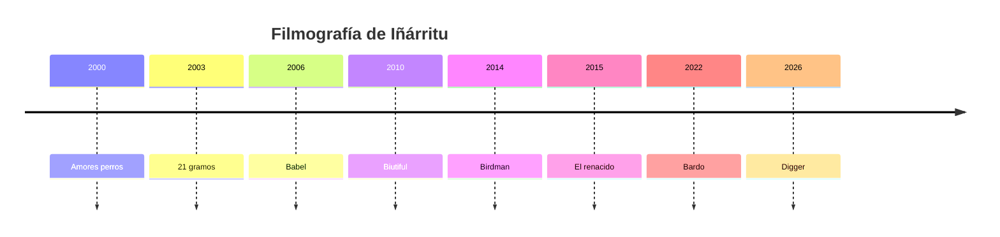

<!--
  Reseña de Birdman (2014) en Markdown
  Autor: Lenny Iborra Morán
  Tarea: AE01_07 · 1.º IABD · Noviembre 2026
-->

<h2 align="center">🎬 Birdman o (la inesperada virtud de la ignorancia)</h2>

<p align="center">
  
  
  
  
</p>

<p align="center"><i>Una reseña de Lenny Iborra Morán</i></p>

# Índice

1. [Ficha técnica](#ficha-técnica)
2. [Sinopsis](#sinopsis)
3. [Reparto y personajes](#reparto-y-personajes)
4. [Análisis](#análisis)
5. [Puntos fuertes y débiles](#puntos-fuertes-y-débiles)
6. [Premios y recepción](#premios-y-recepción)
7. [Valoración personal](#valoración-personal)
8. [Filmografía de Iñárritu](#filmografía-de-iñárritu)
9. [Fuentes](#fuentes)

---

# Ficha técnica

[⬆️ Volver al índice](#índice "Volver al índice")

| Campo | Dato |
| :-- | :-- |
| 🎞️ Título original | *Birdman or (The Unexpected Virtue of Ignorance)* |
| 📅 Año | 2014 |
| 🎬 Dirección | Alejandro González Iñárritu |
| ✍️ Guion | Alejandro G. Iñárritu, Nicolás Giacobone, Alexander Dinelaris Jr. y Armando Bo |
| 📷 Fotografía | Emmanuel Lubezki |
| 🥁 Música | Antonio Sánchez |
| ⏱️ Duración | 119 minutos |
| 🌎 País | Estados Unidos |
| 🇪🇸 Estreno en España | 9 de enero de 2015 |
| 💰 Presupuesto | 18 millones de dólares |
| 🎟️ Recaudación mundial | 103,2 millones de dólares |
| 🎭 Género | Comedia negra · Drama |

[//]: # (Datos de la ficha contrastados con IMDb y Box Office Mojo)

La misma ficha, en formato de datos:

```json
{
  "titulo_original": "Birdman or (The Unexpected Virtue of Ignorance)",
  "anio": 2014,
  "direccion": "Alejandro González Iñárritu",
  "duracion_min": 119,
  "presupuesto_musd": 18,
  "recaudacion_musd": 103.2,
  "oscar": { "nominaciones": 9, "premios": 4 }
}
```

### 💰 ¿Fue rentable?

Para medirlo uso el **retorno de la inversión** (ROI), que compara lo que ganó con lo que costó:

$$
ROI = \frac{\text{recaudación} - \text{presupuesto}}{\text{presupuesto}} \times 100 = \frac{103.2 - 18}{18} \times 100 \approx 473\%
$$

Es decir, recaudó casi **seis veces** lo que costó, algo poco habitual en una película de autor.

---

# Sinopsis

[⬆️ Volver al índice](#índice "Volver al índice")

**Riggan Thomson** fue una estrella de Hollywood gracias a *Birdman*, un superhéroe que interpretó hace décadas y que todavía le persigue.  
Ahora, con su carrera estancada, se juega todo a una carta: adaptar, dirigir y protagonizar una obra de teatro en Broadway basada en un relato de Raymond Carver.

A pocos días del estreno nada sale como debería. Un actor se lesiona en pleno ensayo, el sustituto es un genio tan brillante como insoportable, su hija acaba de salir de rehabilitación y una crítica de teatro ha decidido hundir la obra antes de verla.\
Y, mientras tanto, la voz de Birdman no deja de susurrarle al oído.

> [!TIP]
> Cuando escribí esta reseña, *Birdman* estaba disponible en **Disney+** en España. Si puedes, mírala del tirón y sin darle a <kbd>Pausa</kbd>: la película está pensada para no darte respiro.

---

# Reparto y personajes

[⬆️ Volver al índice](#índice "Volver al índice")

| Actor | Personaje | Quién es |
| :-: | :-: | :-- |
| **Michael Keaton** | Riggan Thomson | Actor en decadencia que fue Birdman |
| **Edward Norton** | Mike Shiner | Actor de método, brillante y egocéntrico |
| **Emma Stone** | Sam Thomson | Hija de Riggan y su asistente |
| **Zach Galifianakis** | Jake | Abogado, productor y mejor amigo de Riggan |
| **Naomi Watts** | Lesley | Actriz que debuta en Broadway |
| **Andrea Riseborough** | Laura | Actriz de la obra y pareja de Riggan |
| **Amy Ryan** | Sylvia | Exmujer de Riggan |
| **Lindsay Duncan** | Tabitha Dickinson | La crítica más temida de Nueva York |

---

# Análisis

[⬆️ Volver al índice](#índice "Volver al índice")

<!-- A partir de aquí se cuenta el final de la película -->

> [!WARNING]
> **Esta sección contiene spoilers.** El desenlace está escondido: solo se muestra si lo despliegas.

Estos son los grandes temas de la película tal y como yo los veo:



## ✍️ Guion

La película es una sátira sobre el ego, la fama y la necesidad de sentirse relevante. Riggan no quiere hacer arte: quiere que le *vuelvan a mirar*.<br>
Lo brillante es que nunca sabemos del todo qué es real y qué está en su cabeza.

La trama sigue una estructura clásica en tres actos:

1. **Planteamiento**: los ensayos.
    - Un foco cae sobre Ralph, el actor secundario, y Riggan cree que lo ha provocado él.
    - Llega Mike Shiner como sustituto y lo pone todo patas arriba.
2. **Nudo**: los preestrenos.
    - Mike bebe ginebra de verdad en escena y destroza una función.
    - Riggan se queda encerrado fuera del teatro y cruza ***Times Square en calzoncillos***.
    - Tabitha Dickinson le promete que acabará con la obra.
3. **Desenlace**: la noche del estreno.



La espiral de decisiones de Riggan, de principio a fin:



<details>
<summary>🎭 <b>Desplegar el desenlace (spoilers)</b></summary>

<br>

- Riggan cambia la pistola de atrezo por una real.
- En la escena final de la obra se dispara delante del público. Sobrevive, pero se ha volado la nariz.
- La crítica de Tabitha, que iba a hundir la obra, resulta entusiasta.
- En el hospital, Riggan se asoma a la ventana. Sam entra, no lo encuentra, mira hacia abajo… y luego hacia el cielo, sonriendo.

</details>

## 📷 Dirección y fotografía

Iñárritu y Lubezki convierten toda la película en una sola toma aparente. La cámara persigue a los personajes por pasillos, camerinos y escenario sin cortar nunca de forma visible.

Casi todo se rodó en el **St. James Theatre** de Broadway, que en la película hace de sí mismo:

<p align="center">
  
</p>

<p align="center"><sub><a href="img/st-james-theatre.jpg" title="Abrir la foto a tamaño completo">Ver la foto del teatro a tamaño completo</a></sub></p>

Antes de rodar, Iñárritu le contó la idea a Mike Nichols, el director de *El graduado*, y este le advirtió:

> "Una comedia se construye a base de cortes."
>
> — **Mike Nichols**, según contó Iñárritu en una mesa redonda de *The Hollywood Reporter*

### 🎥 El falso plano secuencia

Es el gran truco de la película, y lo que más me impactó. No es un único plano real: los cortes están escondidos en pasos por zonas oscuras, giros de cámara y movimientos rápidos.  
El efecto es agotador en el mejor sentido: no hay respiro, igual que no lo tiene Riggan.

> "Me di cuenta de que vivimos nuestras vidas sin edición."
>
> — **Alejandro González Iñárritu**, en una entrevista recogida por *SensaCine*

Para medir lo extremo de esta decisión se usa la **duración media de plano** (*ASL*, del inglés *average shot length*):

$$
ASL = \frac{\text{duración total}}{\text{número de planos}} \approx \frac{7140 \text{ s}}{17} \approx 420 \text{ s} = 7 \text{ min}
$$

Con unos 16 cortes (17 planos) en 119 minutos, cada plano dura de media unos **7 minutos**, cuando en una película comercial actual dura apenas unos segundos.

> [!NOTE]
> Aunque parezca una sola toma, se pueden detectar al menos 16 cortes a lo largo de la película. La idea recuerda a *La soga* (1948), de Alfred Hitchcock, que también simulaba un único plano.

## 🎭 Interpretaciones

**Michael Keaton** hace el papel de su vida. Que el propio Keaton fuera Batman en los 80 y 90 convierte a Riggan en algo casi autobiográfico, y eso se nota en cada gesto.

**Edward Norton** está insoportable en el mejor sentido, y **Emma Stone** tiene el monólogo más duro de la película cuando le suelta a su padre que no le importa a nadie.

Así se cruzan los personajes durante los preestrenos:



## 🥁 Banda sonora

La música es casi solo una batería, la de **Antonio Sánchez**, improvisada sobre las imágenes. Marca el ritmo de los pasos de Riggan y de su ansiedad.<br>
En algunos momentos el batería incluso aparece dentro de la escena.

<p align="center">
  
</p>

El tempo de una batería se mide en pulsaciones por minuto (bpm), y el tiempo entre golpes es $t = \frac{60}{\text{bpm}}$. Por ejemplo, a 120 bpm suena un golpe cada $\frac{60}{120} = 0.5$ segundos: justo el ritmo de alguien que camina deprisa y nervioso por un pasillo.

---

# Puntos fuertes y débiles

[⬆️ Volver al índice](#índice "Volver al índice")

- ✅ **Puntos fuertes**
    - El falso plano secuencia
        - Te mete dentro del teatro y de la cabeza de Riggan.
    - Las interpretaciones
        - Keaton, Norton y Stone, a un nivel altísimo.
    - El disparo de Riggan en el estreno
        - Una de las escenas que más me han impactado en el cine.
    - La batería de Antonio Sánchez
- ❌ **Puntos débiles**
    - Las subtramas de Lesley y Laura se quedan en segundo plano.
    - El ritmo sin cortes puede agotar a quien no entre en el juego.

Antes de verla pensaba que sería ~~otra película de superhéroes~~ algo ligero. Es ***una sátira feroz sobre el ego***.

---

# Premios y recepción

[⬆️ Volver al índice](#índice "Volver al índice")

Fue la gran triunfadora de la 87.<sup>a</sup> edición de los **Óscar**, celebrada en 2015: **9 nominaciones** y **4 estatuillas** 🏆. Ganó $\frac{4}{9} \approx 44.4\%$ de las categorías a las que optaba.

- 🏆 Mejor película
- 🏆 Mejor dirección
- 🏆 Mejor guion original
- 🏆 Mejor fotografía: el segundo Óscar seguido de Lubezki, tras *Gravity*.



La crítica española también se rindió:

> "Iñárritu firma su obra maestra."
>
> — Titular de la crítica de [***eCartelera***](https://www.ecartelera.com/noticias/critica-birdman-o-la-inesperada-virtud-de-la-ignorancia-inarritu-firma-obra-maestra-20951/ "Leer la crítica de eCartelera")

En webs como IMDb la nota de una película no es una media simple, sino una **media bayesiana** que evita que una película con pocos votos se cuele en lo más alto. Es la fórmula que IMDb ha usado para su Top 250:

$$
WR = \frac{v}{v+m} \cdot R + \frac{m}{v+m} \cdot C
$$

Donde $R$ es la nota media de la película, $v$ su número de votos, $m$ los votos mínimos exigidos y $C$ la nota media de todas las películas.

> [!IMPORTANT]
> La banda sonora de Antonio Sánchez se quedó fuera de la carrera al Óscar porque la película también usa música clásica, que no es original.

[//]: # (Premios de la 87.ª edición de los Óscar, celebrada en 2015)

---

# Valoración personal

[⬆️ Volver al índice](#índice "Volver al índice")

***Entre el falso plano secuencia, las actuaciones y el delirio de Riggan con Birdman, te sumerge por completo. De las películas que más he disfrutado viéndola por primera vez.***

| Apartado | Peso | Comentario | Nota |
| :-- | :-: | :-: | --: |
| ✍️ Guion | 30 % | Sátira afilada | 9,5 |
| 📷 Dirección y fotografía | 30 % | El plano secuencia | 10 |
| 🎭 Interpretaciones | 25 % | Keaton en estado de gracia | 10 |
| 🥁 Banda sonora | 15 % | Pura ansiedad a la batería | 9 |
| ⭐ **Nota final** | **100 %** | **Una de mis favoritas** | **9,7** |

<!-- Notas sobre 10 -->

No todos los apartados pesan lo mismo para mí, así que mi nota final es una **media ponderada**:

$$
\bar{x}_w = \frac{\sum_{i=1}^{n} w_i x_i}{\sum_{i=1}^{n} w_i} = 0.30 \cdot 9.5 + 0.30 \cdot 10 + 0.25 \cdot 10 + 0.15 \cdot 9 = 9.7
$$

Y lo comprobé con un pequeño script en `Python`:

```python
notas = {
    "Guion": (9.5, 0.30),
    "Dirección y fotografía": (10, 0.30),
    "Interpretaciones": (10, 0.25),
    "Banda sonora": (9, 0.15),
}

media = sum(nota * peso for nota, peso in notas.values())
print(f"Nota final: {media:.1f} / 10")  # Nota final: 9.7 / 10
```

---

# Filmografía de Iñárritu

[⬆️ Volver al índice](#índice "Volver al índice")

- [ ] *Amores perros* (2000)
- [ ] *21 gramos* (2003)
- [ ] *Babel* (2006)
- [ ] *Biutiful* (2010)
- [x] *Birdman* (2014) 🐦
- [ ] *El renacido* (2015)
- [ ] *Bardo, falsa crónica de unas cuantas verdades* (2022)
- [x] *Digger* (2026)



---

# Fuentes

[⬆️ Volver al índice](#índice "Volver al índice")

[//]: # (Fuentes consultadas para la ficha y los premios)

- [IMDb](https://www.imdb.com/title/tt2562232/ "Ficha de Birdman en IMDb")
- [Box Office Mojo](https://www.boxofficemojo.com/title/tt2562232/ "Presupuesto y recaudación")
- [SensaCine](https://www.sensacine.com/peliculas/pelicula-216633/ "Ficha de Birdman en SensaCine")
- [Letterboxd](https://letterboxd.com/film/birdman-or-the-unexpected-virtue-of-ignorance/ "Birdman en Letterboxd")
- [Entrevista a Iñárritu en SensaCine](https://www.sensacine.com/noticias/cine/noticia-1000147285/ "Fuente de la cita de Iñárritu")
- [Mike Nichols y el plano secuencia, en SensaCine](https://www.sensacine.com/noticias/cine/noticia-1000219253/ "Fuente de la cita de Mike Nichols")

Imágenes guardadas en el proyecto:

- [St. James Theatre](img/st-james-theatre.jpg "Fachada del teatro donde se rodó la película")
- [Times Square](img/times-square.jpg "Times Square de noche")
- [Batería](img/bateria.jpg "Batería de jazz")

Para subir los cambios del README y las imágenes al repositorio:

```bash
git add README.md img/
git commit -m "Reseña de Birdman en Markdown"
git push origin main
```

